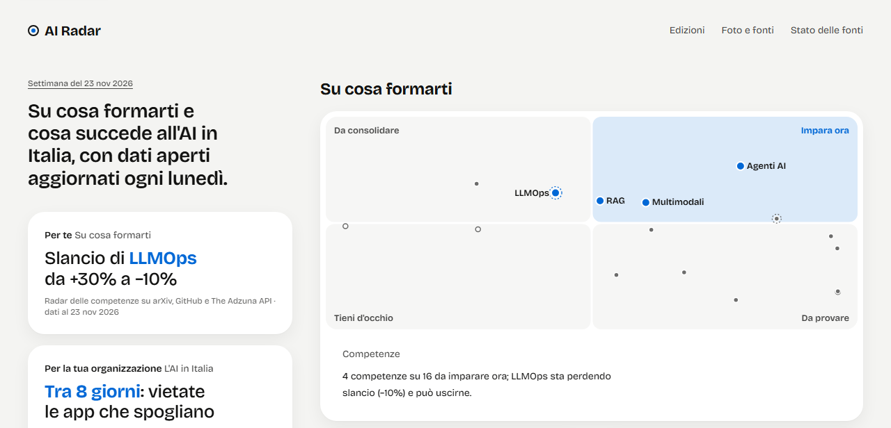

# AI Radar

<picture>
  <source media="(prefers-color-scheme: dark)" srcset="guida/immagini/home-scura.png">
  
</picture>

**In English.** A public dashboard on open data that updates itself every Monday: [simones99.github.io/ai-radar][sito]. It shows which AI skills to learn, from research, open source and job ads in Europe and the US, and where Italy and Europe stand in the AI supply chain. A Python pipeline on GitHub Actions collects the data, and a Svelte + D3 app on GitHub Pages shows it. Every source is licensed and cited; pipeline and app are tested in CI. Interface and docs are in Italian.

Una dashboard pubblica su dati aperti, che si aggiorna da sola ogni lunedì: **[simones99.github.io/ai-radar][sito]**. Ha due teste:

- **Su cosa formarti**, per le persone: un radar di 16 competenze AI che incrocia ricerca, open source e annunci di lavoro, in Europa, negli USA e in Italia.
- **L'AI in Italia**, per le organizzazioni: dove stanno l'Italia e l'Europa nella catena dell'AI, imprese, lavoro, AI Act e rapporti.

Ogni lunedì esce anche un'edizione fissa della settimana, con archivio e feed RSS. Tutto gira gratis su GitHub.

**Come si legge, come se ne pubblica una copia, come si mantiene: [la guida][guida].**

## Provarlo in locale

Servono Python 3.12 e Node 24.

```bash
python -m venv .venv && source .venv/bin/activate      # Windows: .venv\Scripts\activate
pip install -r requirements.txt
npm ci --prefix web
python -m pipeline.run --months 7                       # dati veri, storico corto
python scripts/build_site.py                            # copia i dati e costruisce _site/
cd web && npm run preview                               # apre il sito su http://localhost:4173
```

Test, chiavi ed edizioni di prova: [Provarlo in locale][in-locale], nella guida.

## Nella guida

- [Come si legge il radar][radar] e [GeopoliticAI][geopoliticai]
- [Pubblicarne una copia in 10 minuti][pubblicare]
- [Edizioni, feed e correzioni][edizioni]
- [Fonti e licenze][fonti] e [decisioni][decisioni]

## Licenza

Codice MIT. I dati restano dei loro autori, ognuno con la sua licenza: arXiv, GitHub, *The Adzuna API*, Eurostat, Epoch AI, Our World in Data, USGS, Commissione europea ed ETO (CC BY-NC, solo uso non commerciale). Il dettaglio è in [Fonti e licenze][fonti].

<!-- Gli indirizzi del sito e della guida, in un posto solo. Ogni pagina della guida è il file guida/<nome>.md: tests/test_readme.py lo controlla. -->
[sito]: https://simones99.github.io/ai-radar/
[guida]: https://simones99.github.io/ai-radar/guida/
[in-locale]: https://simones99.github.io/ai-radar/guida/in-locale/
[radar]: https://simones99.github.io/ai-radar/guida/radar/
[geopoliticai]: https://simones99.github.io/ai-radar/guida/geopoliticai/
[pubblicare]: https://simones99.github.io/ai-radar/guida/pubblicare/
[edizioni]: https://simones99.github.io/ai-radar/guida/edizioni/
[fonti]: https://simones99.github.io/ai-radar/guida/fonti/
[decisioni]: https://simones99.github.io/ai-radar/guida/decisioni/
